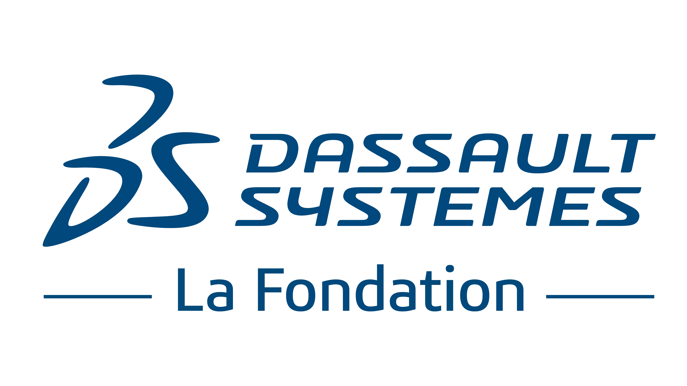
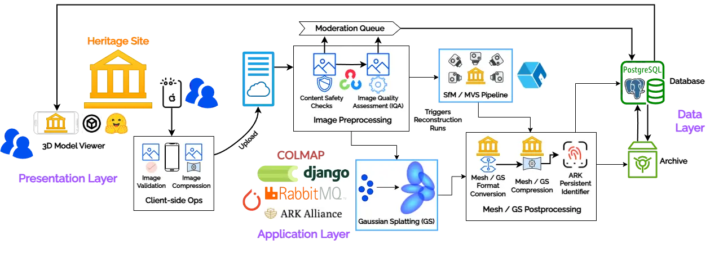

<h1 align="center">
    <picture>
        <source srcset="https://raw.githubusercontent.com/project-tirtha/tirtha-public/main/media/images/tirtha-logo-dark.webp" media="(prefers-color-scheme: dark)">
        
        </picture>
    $\color{#ff4c40}{\textrm{Project Tirtha [Beta]}}$
    <!-- Project Tirtha [Beta] -->
</h1>

<div align="center">
    <a href="https://www.niser.ac.in" target="_blank">
        <picture>
            <source srcset="./media/images/niser-logo-dark.webp" media="(prefers-color-scheme: dark)">
            
        </picture>
    </a>
    <a href="https://www.lafondation3ds.org/" target="_blank">
        <picture>
            <source srcset="./media/images/lfds-logo-dark.webp" media="(prefers-color-scheme: dark)">
            
        </picture>
    </a>
    <a href="https://odisha.gov.in/explore-odisha/state-archaeology" target="_blank">
        <picture>
            <source srcset="./media/images/odisha-logo-dark.webp" media="(prefers-color-scheme: dark)">
            
        </picture>
    </a>
</div>

---

[](https://matrix.to/#/#tirtha:matrix.org) [](https://signal.group/#CjQKIN_Ry9rBYUZJn8pLEkfWMAkZvO2FGopPalXsWPMZauXyEhBT1GdJYb5C_PJV0qE5VTLj) 
[](https://github.com/project-tirtha/tirtha-public/discussions)

---

> [!note]
> Please go here for the Tirtha website: https://smlab.niser.ac.in/project/tirtha/.

---

[Project Tirtha](https://smlab.niser.ac.in/project/tirtha/) is an _academic initiative_ dedicated to creating 3D models of cultural heritage sites using crowdsourced images. The word _Tirtha_ is Sanskrit for "a place of pilgrimage" and is commonly used to refer to the sacred sites of Hinduism, Jainism, and Buddhism.

Our goal is to preserve and showcase the beauty and cultural significance of heritage sites around the world. By enabling the general public to contribute images and by providing open access to the resulting 3D models, we aim to increase awareness and appreciation of these invaluable cultural landmarks. We believe this participatory approach can inspire future generations to protect and maintain them for years to come.

Project Tirtha leverages recent advancements in _artificial intelligence_ and _computer vision_ to reimagine digital heritage. It was born out of both a growing need for accessible digital preservation and as a research-driven effort to explore scalable, community-powered digital reconstruction of cultural sites.

This project is fully open-source under the [GNU Affero General Public License v3.0](./LICENSE) and is under active development. All contributions are welcome — please see [CONTRIBUTING.md](./CONTRIBUTING.md) for details on how to get involved.

For academic use, see [Citation](#citation) for information on how to cite this project. A [CITATION.cff](./CITATION.cff) file is also available in the repository.

Current statistics (sites, contributors, images and reconstructions) are shown on the [Tirtha website](https://smlab.niser.ac.in/project/tirtha/).


## Current Stack

- **Backend:** Django 5.2 (a single `tirtha` app), Celery workers on two queues (`ingest` for uploads and image checks, `recon` for reconstruction), PostgreSQL and RabbitMQ in production, SQLite with eager Celery for development and tests.
- **Reconstruction:** COLMAP for structure-from-motion and [FastGS](https://github.com/fastgs/FastGS) for Gaussian Splatting, run in its own environment. Splats are compressed for the web with [splat-transform](https://github.com/playcanvas/splat-transform). The AliceVision photogrammetry path is kept for meshes. The Django-free reconstruction code lives in a sibling repository, [`tirtha-recon`](https://github.com/project-tirtha/tirtha-recon).
- **Image checks:** [NudeNet](https://github.com/notAI-tech/NudeNet) for content safety on CPU, plus sharpness and exposure measurements.
- **Frontend:** React 19 + Vite + Tailwind, [MapLibre GL JS](https://github.com/maplibre/maplibre-gl-js) for the map, and a Gaussian-splat viewer built on three.js ([GaussianSplats3D](https://github.com/mkkellogg/GaussianSplats3D)) with KTX2/[Basis Universal](https://github.com/BinomialLLC/basis_universal) textures. Available in English, Odia and Hindi.
- **Identifiers:** every published model gets an [ARK](https://arks.org/) persistent identifier.


## System Architecture

<picture>
    <source srcset="./media/images/architecture-GS-dark.webp" media="(prefers-color-scheme: dark)">
    
</picture>

[See the paper](#citation) for more details.


## Installation

Tirtha is two repositories, cloned side by side. `pyproject.toml` installs `tirtha-recon` from `../tirtha-recon`:
```bash
git clone https://github.com/project-tirtha/tirtha-public.git
git clone https://github.com/project-tirtha/tirtha-recon.git
cd tirtha-public
uv sync --frozen
```
Then, follow the instructions in [DEVELOP.md](./DEVELOP.md) for development setup or [DEPLOY.md](./DEPLOY.md) for production/deployment setup.


## Citation

Please cite the following paper if you use this software in your work ([arXiv](https://arxiv.org/abs/2308.01246) | [ACM Digital Library](https://dl.acm.org/doi/10.1145/3611314.3615904)):

```bibtex
@inproceedings{10.1145/3611314.3615904,
    author = {Shivottam, Jyotirmaya and Mishra, Subhankar},
    title = {Tirtha - An Automated Platform to Crowdsource Images and Create 3D Models of Heritage Sites},
    year = {2023},
    isbn = {9798400703249},
    publisher = {Association for Computing Machinery},
    address = {New York, NY, USA},
    url = {https://doi.org/10.1145/3611314.3615904},
    doi = {10.1145/3611314.3615904},
    abstract = {Digital preservation of Cultural Heritage (CH) sites is crucial to protect them against damage from natural disasters or human activities. Creating 3D models of CH sites has become a popular method of digital preservation thanks to advancements in computer vision and photogrammetry. However, the process is time-consuming, expensive, and typically requires specialized equipment and expertise, posing challenges in resource-limited developing countries. Additionally, the lack of an open repository for 3D models hinders research and public engagement with their heritage. To address these issues, we propose Tirtha, a web platform for crowdsourcing images of CH sites and creating their 3D models. Tirtha utilizes state-of-the-art Structure from Motion (SfM) and Multi-View Stereo (MVS) techniques. It is modular, extensible and cost-effective, allowing for the incorporation of new techniques as photogrammetry advances. Tirtha is accessible through a web interface at https://smlab.niser.ac.in/project/tirtha/ and can be deployed on-premise or in a cloud environment. In our case studies, we demonstrate the pipeline’s effectiveness by creating 3D models of temples in Odisha, India, using crowdsourced images. These models are available for viewing, interaction, and download on the Tirtha website. Our work aims to provide a dataset of crowdsourced images and 3D reconstructions for research in computer vision, heritage conservation, and related domains. Overall, Tirtha is a step towards democratizing digital preservation, primarily in resource-limited developing countries.},
    booktitle = {Proceedings of the 28th International ACM Conference on 3D Web Technology},
    articleno = {11},
    numpages = {15},
    keywords = {photogrammetry, open source, digital heritage, crowdsourcing, 3D dataset},
    location = {San Sebastian, Spain},
    series = {Web3D '23}
}
```

You can also use GitHub's citation feature to generate a citation for this repository. See [here](https://docs.github.com/en/repositories/managing-your-repositorys-settings-and-features/customizing-your-repository/about-citation-files) for more details.


## Acknowledgment

This project received its initial funding from [La Fondation Dassault Systèmes](https://www.lafondation3ds.org/), to whom we are deeply grateful. We also thank the following individuals for their contributions to the project's development:
- [Jyotirmaya Shivottam | JeS24](https://github.com/JeS24)
- [Anubhav Vishwakarma | AvTheBlackBird](https://github.com/AvTheBlackBird)
- [Om Kumar | W-OK-E](https://github.com/W-OK-E)
- [Annada Prasad Behera | annadapb](https://github.com/annadapb)
- Debiprasad Bedanta, for the React user interface

We are grateful to the developers of the following open-source libraries, which help make this project a reality:

- [COLMAP](https://colmap.github.io/), available under the [BSD 3-Clause License](https://github.com/colmap/colmap/blob/main/LICENSE.txt).
- [FastGS](https://github.com/fastgs/FastGS), available under the MIT License. Its CUDA rasteriser derives from the Inria 3D Gaussian Splatting code and is under the [Inria/MPII Gaussian-Splatting License](https://github.com/graphdeco-inria/gaussian-splatting/blob/main/LICENSE.md), which permits non-commercial research use only. FastGS is not distributed with Tirtha; it runs from its own environment.
- [splat-transform (PlayCanvas)](https://github.com/playcanvas/splat-transform)
- [Basis Universal](https://github.com/BinomialLLC/basis_universal), available under the [Apache 2.0 License](https://github.com/BinomialLLC/basis_universal/blob/master/LICENSE). Its transcoder is bundled in `frontend/public/basis/`.
- [MapLibre GL JS](https://github.com/maplibre/maplibre-gl-js), available under the BSD 3-Clause License.
- [NudeNet](https://github.com/notAI-tech/NudeNet), available under the MIT License.
- [GaussianSplats3D](https://github.com/mkkellogg/GaussianSplats3D) and [three.js](https://github.com/mrdoob/three.js)
- [React](https://github.com/facebook/react) and [Vite](https://github.com/vitejs/vite)
- [AliceVision Meshroom](https://github.com/alicevision/Meshroom/), available under the [Mozilla Public License 2.0](https://github.com/alicevision/Meshroom/blob/develop/LICENSE-MPL2.md).
- [nerfstudio](https://github.com/nerfstudio-project)
- [3D Gaussian Splatting Reference (Inria)](https://github.com/graphdeco-inria/gaussian-splatting)
- [MANIQA](https://github.com/IIGROUP/MANIQA) and [nsfw_model](https://github.com/GantMan/nsfw_model), used by earlier versions of Tirtha.
- [Cesium `obj2gltf`](https://github.com/CesiumGS/obj2gltf)
- [`gltfpack`](https://github.com/zeux/meshoptimizer)
- [Google `<model-viewer>`](https://github.com/google/model-viewer)
- [3D Gaussian Splat Viewer](https://github.com/antimatter15/splat)
- [3D Gaussian Splatting Converter](https://github.com/francescofugazzi/3dgsconverter)
- [Google Fonts | Rubik](https://github.com/googlefonts/rubik)
- [Google Fonts | Material Icons](https://github.com/google/material-design-icons)
- [Django](https://github.com/django/django)
- [jQuery](https://github.com/jquery/jquery)
- [gunicorn](https://github.com/benoitc/gunicorn)
- [nginx](https://github.com/nginx/nginx)
- [Celery](https://github.com/celery/celery)
- [RabbitMQ](https://github.com/rabbitmq)
- [OpenCV](https://github.com/opencv/opencv)
- [Docker](https://github.com/docker)
- [ffmpeg](https://www.ffmpeg.org/)

See [THIRD_PARTY_NOTICES.md](./THIRD_PARTY_NOTICES.md) for the licences of bundled third-party files and data.

We also thank Odisha State Archaeology for their support.

---

&copy; 2023-26 Project Tirtha,
[Subhankar Mishra's Lab](https://www.niser.ac.in/~smishra/),
[School of Computer Sciences](https://www.niser.ac.in/scos/), [NISER](https://www.niser.ac.in/).
All rights reserved.
